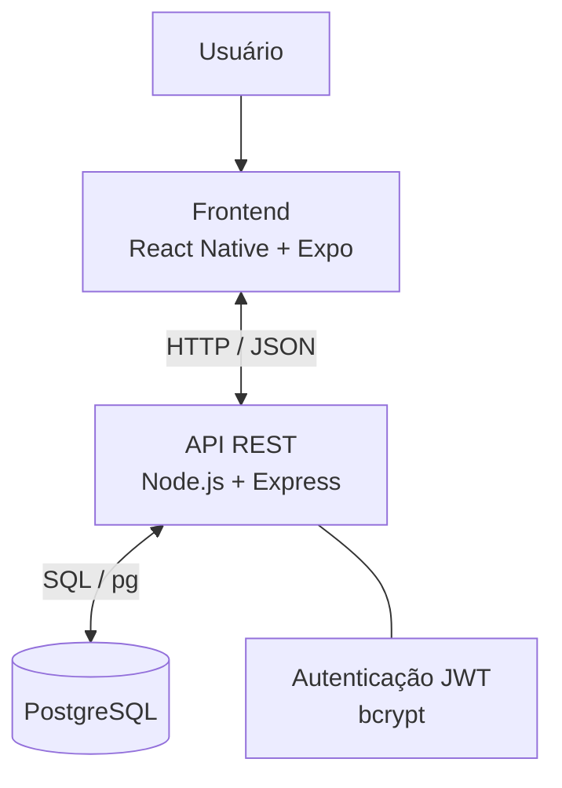

<div align="center">


# Rolê SP

**Descubra São Paulo. Encontre seu próximo rolê.**

Aplicativo de descoberta de locais de lazer, cultura e entretenimento na cidade de São Paulo.


[Sobre](#sobre-o-projeto) •
[Funcionalidades](#funcionalidades) •
[Arquitetura](#arquitetura) •
[Instalação](#instalação-e-execução) •
[Testes](#testes-e-qualidade-de-software) •
[Protótipo](#protótipo)

</div>

---

## Sobre o projeto

O **Rolê SP** é um aplicativo desenvolvido como projeto acadêmico do curso de Análise e Desenvolvimento de Sistemas (ADS) da FATEC.

O projeto tem como propósito facilitar a descoberta de opções de lazer, cultura e entretenimento na cidade de São Paulo, reunindo informações relevantes em uma única plataforma e auxiliando os usuários no planejamento de suas experiências pela cidade.

### Problematização

Apesar da diversidade de opções culturais e de lazer existentes em São Paulo, as informações sobre estabelecimentos, atrações, preços e localização encontram-se frequentemente dispersas em diferentes plataformas.

Essa fragmentação dificulta a descoberta de novos lugares, a comparação de alternativas e a tomada de decisão de acordo com as preferências, a localização e o orçamento dos usuários.

### Proposta de solução

O Rolê SP propõe uma experiência centralizada de descoberta de locais, com mecanismos de busca, filtros e informações que auxiliam o usuário a decidir onde ir e como planejar seu próximo rolê.

### Objetivos

- Facilitar o acesso a informações sobre opções de lazer em São Paulo.
- Auxiliar na descoberta de novos estabelecimentos e espaços culturais.
- Permitir buscas e filtragens de acordo com as preferências dos usuários.
- Disponibilizar informações relevantes para o planejamento de visitas.
- Valorizar a diversidade cultural e as possibilidades de lazer da cidade.

### Público-alvo

Moradores e visitantes de São Paulo, maiores de 18 anos, interessados em descobrir novas experiências de lazer, cultura, gastronomia e entretenimento.

## Funcionalidades

### MVP

- [x] Cadastro de usuários.
- [x] Login e autenticação com JWT.
- [x] Exploração de locais cadastrados no banco de dados.
- [x] Integração entre frontend e API REST.
- [x] Busca de locais por nome.
- [x] Filtros por categoria, região e faixa de preço.
- [x] Consulta aos detalhes dos estabelecimentos.
- [x] Página de informações antes de sair.
- [x] Consulta aos dados do usuário autenticado pela API.

### Evoluções previstas

- [ ] Ampliação do catálogo e das imagens dos locais.
- [ ] Comparação de opções de lazer.
- [ ] Avaliações e contribuições da comunidade.
- [ ] Denúncia e moderação de conteúdos.
- [ ] Integração com serviços de mapas e rotas.
- [ ] Painel administrativo.
- [ ] Parcerias e identificação de conteúdos patrocinados.

## Tecnologias utilizadas

| Camada | Tecnologias |
| --- | --- |
| Frontend | React Native, Expo, TypeScript |
| Navegação | Expo Router |
| Comunicação HTTP | Axios |
| Backend | Node.js, Express |
| Banco de dados | PostgreSQL |
| Autenticação | JSON Web Token (JWT) |
| Proteção de senhas | bcrypt |
| Armazenamento local seguro | Expo SecureStore |
| Testes unitários | Node.js Test Runner, Jest, Jest Expo |
| Prototipação | Figma |
| Versionamento | Git e GitHub |

## Arquitetura

O projeto utiliza uma arquitetura cliente-servidor, com separação entre a interface do aplicativo, a API responsável pelas regras de negócio e a camada de persistência de dados.



### Estrutura do repositório

```text
role-sp/
├── backend/
│   ├── src/
│   │   ├── config/
│   │   ├── controller/
│   │   ├── middlewares/
│   │   ├── repository/
│   │   ├── routes/
│   │   ├── utils/
│   │   ├── app.js
│   │   └── server.js
│   ├── .env.example
│   └── package.json
│
├── frontend/
│   ├── assets/
│   ├── src/
│   │   ├── app/
│   │   ├── components/
│   │   ├── constants/
│   │   ├── services/
│   │   └── utils/
│   ├── .env.example
│   └── package.json
│
└── README.md
```

## API REST

### Principais endpoints

| Método | Endpoint | Descrição |
| --- | --- | --- |
| GET | `/` | Verificação da disponibilidade da API |
| GET | `/locais` | Listagem e busca de locais |
| GET | `/locais/:id` | Consulta aos detalhes de um local |
| POST | `/auth/cadastro` | Cadastro de usuário |
| POST | `/auth/login` | Autenticação de usuário |
| GET | `/auth/eu` | Consulta ao usuário autenticado |

O endpoint `/locais` aceita parâmetros de consulta como:

- `nome`
- `bairro`
- `categoria`
- `faixaPreco`
- `parceiro`
- `notaMinima`

Exemplo de consulta:

```http
GET /locais?nome=MASP
```

O endpoint `/auth/eu` requer um token JWT válido, enviado no cabeçalho `Authorization` no formato `Bearer`.

## Instalação e execução

### Pré-requisitos

- Git.
- Node.js 22 LTS (versão 22.13 ou superior da série 22).
- npm.
- Acesso a uma instância PostgreSQL com o esquema do projeto.
- Expo Go compatível, emulador Android ou navegador web.

### 1. Clonar o repositório

```bash
git clone https://github.com/jonatasprado2610/role-sp.git
cd role-sp
```

### 2. Configurar o backend

```bash
cd backend
npm ci
```

Crie um arquivo `.env` a partir do arquivo `.env.example`.

```dotenv
PORT=3000
DATABASE_URL=
JWT_SECRET=
JWT_EXPIRA_EM=7d
```

| Variável | Descrição |
| --- | --- |
| `PORT` | Porta de execução da API |
| `DATABASE_URL` | URL de conexão com o PostgreSQL |
| `JWT_SECRET` | Chave secreta para assinatura dos tokens |
| `JWT_EXPIRA_EM` | Tempo de validade dos tokens |

A URL do banco deve ser obtida com a equipe responsável ou corresponder a uma instância própria devidamente configurada.

Para gerar uma chave JWT local:

```bash
node -e "console.log(require('crypto').randomBytes(32).toString('hex'))"
```

> Nunca compartilhe credenciais ou inclua arquivos `.env` no versionamento.

Inicie o backend:

```bash
npm start
```

A API estará disponível em:

```text
http://localhost:3000
```

### 3. Configurar o frontend

Em outro terminal, a partir da raiz do projeto:

```bash
cd frontend
npm ci
```

Crie um arquivo `.env` a partir do `.env.example`.

Para execução no navegador:

```dotenv
EXPO_PUBLIC_API_URL=http://localhost:3000
```

Para execução em um dispositivo físico, utilize o endereço IP do computador que está executando o backend, desde que ambos estejam na mesma rede.

Inicie o frontend:

```bash
npm start
```

O Expo disponibilizará as opções de execução:

| Opção | Descrição |
| --- | --- |
| `w` | Abrir no navegador |
| `a` | Abrir no emulador Android |
| QR Code | Abrir em dispositivo compatível com Expo Go |

Mantenha o backend em execução durante a utilização do aplicativo.

> A execução completa depende de uma instância PostgreSQL previamente configurada. Os scripts de criação e carga inicial do banco ainda precisam ser disponibilizados no repositório.

## Testes e qualidade de software

O projeto contempla uma iniciativa de implementação de testes unitários automatizados, com o objetivo de verificar regras de negócio, funções utilitárias e mecanismos de autenticação.

### Ferramentas


### Escopo dos testes

| Camada | Grupo de testes | Quantidade |
| --- | --- | ---: |
| Backend | Validação de e-mail | 8 |
| Backend | Validação de maioridade e data de nascimento | 10 |
| Backend | Autenticação JWT | 8 |
| Frontend | Busca e filtragem de rolês | 14 |
| Frontend | Validação de e-mail | 8 |
| Frontend | Formatação de notas | 6 |
| Frontend | Tratamento de parâmetros | 10 |
| | **Total** | **64** |

### Resultados registrados

| Camada | Total | Aprovados | TODO | Falhas bloqueantes |
| --- | ---: | ---: | ---: | ---: |
| Backend | 26 | 25 | 1 | 0 |
| Frontend | 38 | 38 | 0 | 0 |
| **Total** | **64** | **63** | **1** | **0** |

As suítes foram executadas em ambientes Windows e Linux (Debian).

Durante os testes, foi identificado um defeito relacionado à validação de datas de nascimento inexistentes. O cenário permanece registrado como TODO até sua correção.

- [Issue #1 — Defeito na validação de maioridade](https://github.com/jonatasprado2610/role-sp/issues/1)
- [Pull Request #2 — Implementação dos testes unitários](https://github.com/jonatasprado2610/role-sp/pull/2)

> Os resultados correspondem à versão testada na branch de desenvolvimento dos testes. A integração à branch principal está em andamento.

### Execução dos testes

Os comandos abaixo estarão disponíveis na branch que contém a implementação dos testes e, posteriormente, na branch principal após sua integração.

**Backend:**

```bash
cd backend
npm ci
npm test
```

**Frontend:**

```bash
cd frontend
npm ci
npm test -- --runInBand
```

## Protótipo

O projeto foi precedido pela elaboração de um protótipo navegável de alta fidelidade no Figma, utilizado para definição das interfaces, fluxos de navegação e experiência do usuário.

[Acessar protótipo no Figma](https://www.figma.com/design/xkzXvTmb2PD65yv0WJjdiH/Tcc-ADS?node-id=1-2)

## Sustentabilidade e evolução

Como possibilidade de sustentabilidade financeira, o projeto prevê parcerias com estabelecimentos e divulgação de conteúdos patrocinados, devidamente identificados na plataforma.

O modelo de monetização e os custos operacionais serão aprofundados em etapas futuras do projeto.

## Contribuições

O desenvolvimento é realizado colaborativamente por meio do GitHub, utilizando branches, commits, issues e pull requests.

[Conheça os contribuidores do projeto](https://github.com/jonatasprado2610/role-sp/graphs/contributors).

---

<div align="center">

**Rolê SP — Descubra novas possibilidades pela cidade.**

Projeto acadêmico · Análise e Desenvolvimento de Sistemas · FATEC · 2026

</div>
